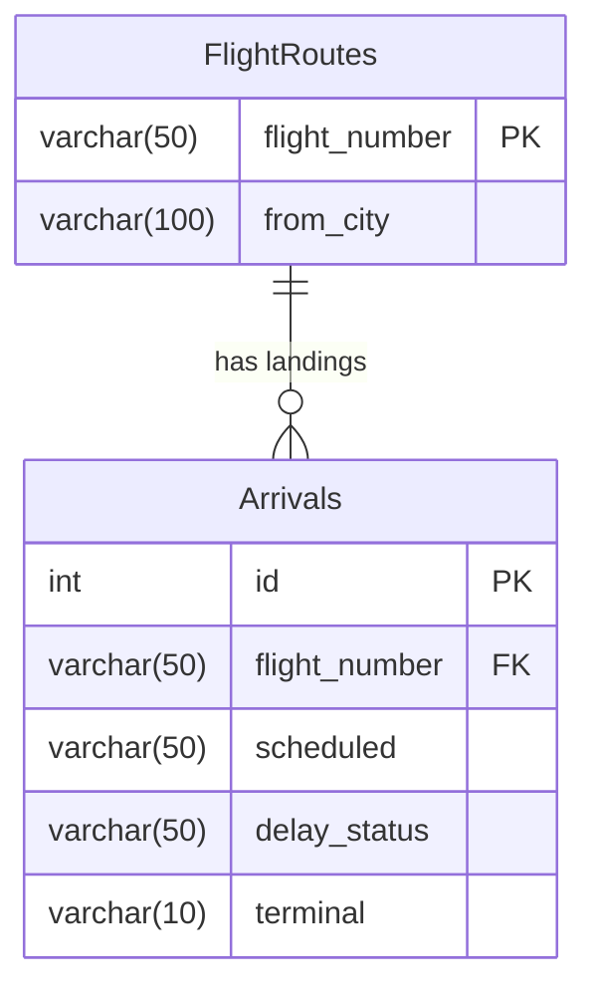

# Flight Arrivals Management System (`JDBC_FlightManager`)

**Course:** Software Engineering Methods (Academic Year 2026–2027)  
**Institution:** Braude College of Engineering | Department of Software Engineering  
**Database Engine:** MySQL 8.0+ | **Language:** Java 25 LTS (JDBC)

---

## 1. Project Description
`JDBC_FlightManager` is the **Data Access Layer (DAL)** of an airport flight arrivals management system.
Raw landing telemetry (`arrived_flights.csv`, 299 records) is ingested into a flat MySQL table (`rawflights`) in the
`FlightDB` schema and then normalized into **Third Normal Form (3NF)** – a parent table `FlightRoutes` and a child
table `Arrivals` linked by a Foreign Key. On top of this schema the project provides JDBC programs that:

* `FlightManagerBase` – connects with try-with-resources and prints the joined arrivals board (`INNER JOIN`, 299 rows).
* `AdvancedFlightDispatcher` – updates several arrivals at once with a single `PreparedStatement` batch (`addBatch` / `executeBatch`).
* `FlightViewer` – filters arrivals by terminal with a parameterized `INNER JOIN` sorted by `scheduled ASC`.
* `SimpleFlightUpdater` – updates the status of flight `LX354`. It was first written with a vulnerable `Statement`
  (string concatenation) to demonstrate a live **SQL Injection** attack, and then refactored into a secure
  `PreparedStatement` with full Javadoc.

A complete database backup (DDL + data) is provided in `FlightDB_Dump.sql`.

---

## 2. Engineering Team Details (Single-Workstation Driver–Navigator)

| Role | Full Name | Student ID | Braude Academic Email |
| :--- | :--- | :--- | :--- |
| **Student A** | `Adam Ziad ` | `325488559` | `Adam.zayyad@e.braude.ac.il` |
| **Student B** | `Jiryes Daood]` | `213559677` | `Jiryes.daood@e.braude.ac.il` |

* **Group Number:** `G[XX]`
* **GitHub Repository URL:**: https://github.com/adamcodes11-star/JDBC_FlightManager

**Work distribution:** Parts 1–2 and 3.1 – joint work; Part 3.2 (`SimpleFlightUpdater`) – Student A as Driver,
Student B as Navigator; Part 3.3 (`AdvancedFlightDispatcher`) – Student B as Driver, Student A as Navigator;
Parts 4–6 – joint work.

---

## 3. Technology Stack
* **Runtime & JDK:** BellSoft Liberica Full JDK 25 LTS
* **Database Server:** MySQL Server 8.0+ (`FlightDB` schema)
* **JDBC Driver:** MySQL Connector/J 9.5.0 (`mysql-connector-j-9.5.0.jar`)
* **IDE & Database Tooling:** IntelliJ IDEA Ultimate (Built-in Database Console & SQL Generator)
* **Local AI Assistant:** LM Studio (`Qwen2.5-Coder-7B-Instruct`) integrated via the Continue plugin
* **Version Control:** Git & GitHub

---

## 4. Database Normalization (3NF) & Functional Dependencies ($F$)

### 4.1 Functional Dependencies ($F$) in `rawflights`
The imported flat relation is `rawflights(scheduled, flight, fromC, delay, terminal)`.

* $\text{flight} \rightarrow \text{fromC}$ – a flight number uniquely determines its departure city.
* $\{\text{flight}, \text{scheduled}\} \rightarrow \{\text{fromC}, \text{delay}, \text{terminal}\}$ – a specific landing
  event (a flight at a given scheduled time) determines its status and terminal.

Because the same flight lands on multiple dates/schedules, `flight` alone is **not** a candidate key for a landing-event
row; the landing event is identified by $\{\text{flight}, \text{scheduled}\}$ (in the normalized schema – by the
surrogate key `id`).

### 4.2 Why `rawflights` Violated 3NF
`fromC` is a non-key attribute that depends on `flight`, which is only **part** of the key and not a superkey.
Hence `fromC` depends on the key through `flight` and is stored again in every landing row (transitive redundancy).
This causes three anomalies:

* **Update anomaly** – changing a route's departure city requires updating every landing row of that flight; missing
  one leaves the data inconsistent.
* **Insertion anomaly** – a new route (flight number + city) cannot be recorded until an actual landing exists.
* **Deletion anomaly** – deleting a flight's landing history also deletes the only record of the route and its city.

Decomposing on $\text{flight} \rightarrow \text{fromC}$ stores each city exactly once and removes all three anomalies.
The decomposition is lossless (the common attribute `flight_number` is the key of `FlightRoutes`) and
dependency-preserving.

### 4.3 Decomposed 3NF Relational Schema
* **`FlightRoutes`** (parent)
  * `flight_number` VARCHAR(50) – **PRIMARY KEY**
  * `from_city` VARCHAR(100) NOT NULL
* **`Arrivals`** (child)
  * `id` INT AUTO_INCREMENT – **PRIMARY KEY**
  * `flight_number` VARCHAR(50) NOT NULL – **FOREIGN KEY** → `FlightRoutes(flight_number)` `ON DELETE CASCADE`
  * `scheduled` VARCHAR(50)
  * `delay_status` VARCHAR(50) (mapped as-is from `delay`)
  * `terminal` VARCHAR(10)

> **Design note:** `scheduled` is stored as VARCHAR(50) to simplify CSV ingestion. Since times are zero-padded
> `HH:MM:SS`, `ORDER BY scheduled ASC` sorts chronologically. Production systems would use `TIME`/`DATETIME`.

---

## 5. Independent AI Prompt (Part 4 – `FlightViewer.java`)

```text
Write a complete Java class named FlightViewer with a main method.
Use a Scanner to prompt the user for the MySQL root password, then connect to the MySQL database FlightDB using DriverManager with the URL "jdbc:mysql://localhost:3306/FlightDB?allowLoadLocalInfile=true&allowPublicKeyRetrieval=true&serverTimezone=Asia/Jerusalem&useSSL=false" and the user "root".
Then prompt the user for a target terminal number. The valid terminals in the dataset are 2, 3, 4 and 5; if the user enters anything else, print an error message and exit.
Always use try-with-resources for the Connection, the PreparedStatement and the ResultSet.
Use a secure PreparedStatement with a '?' placeholder (never string concatenation) to execute this query:
SELECT a.id, a.flight_number, r.from_city, a.scheduled, a.delay_status, a.terminal FROM Arrivals a INNER JOIN FlightRoutes r ON a.flight_number = r.flight_number WHERE a.terminal = ? ORDER BY a.scheduled ASC
The terminal column is VARCHAR(10), so bind the parameter with pstmt.setString(1, terminal) and not setInt.
Print the results as a formatted table with the columns ID, Flight, From, Scheduled, Status and Terminal using System.out.printf, and print the total number of flights found at the end.
Catch SQLException and print the error code and message. Add Javadoc comments to the class and the main method.
```

---

## 6. Entity Relationship Diagram (ERD)



---

## 7. Security Audit Summary (Part 5 – SQL Injection Mitigation)
* **Attack Payload Tested:** `Landed' #`
* **Vulnerability Analysis (`Statement`):** The original `SimpleFlightUpdater` built the command by raw string
  concatenation: `"UPDATE Arrivals SET delay_status = '" + userInput + "' WHERE flight_number = 'LX354'"`.
  With the payload the server received `UPDATE Arrivals SET delay_status = 'Landed' #' WHERE flight_number = 'LX354'`.
  The single quote (`'`) closed the string literal early and `#` opened a MySQL single-line comment, so the whole
  `WHERE` clause was ignored. The statement became an unconditional `UPDATE` and **all 299 rows** of `Arrivals`
  were overwritten to `'Landed'` instead of one row.
* **Remediation (`PreparedStatement`):** The class was refactored to
  `UPDATE Arrivals SET delay_status = ? WHERE flight_number = ?` with values bound via `setString`. The SQL structure
  is fixed and pre-compiled before any input is supplied, and bound values are always transmitted as data literals
  (special characters are escaped), never parsed as SQL syntax or comments. Re-running the same payload updated
  **exactly 1 row** (`LX354`), whose status is now literally `Landed' #`, while the other 298 flights stayed intact.
  Connection and statement are managed with try-with-resources, and the class carries Javadoc documenting the
  vulnerability and the fix.

---

## 8. License
Distributed under the **Braude College Academic License** (Software Engineering Methods, 2026–2027).
